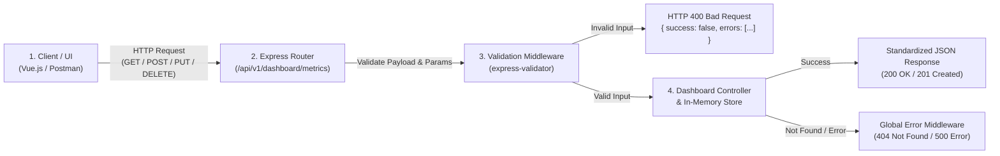

# Interactive Dashboard with Real-Time Updates and API Request Validation
### Sri Krishna College of Engineering and Technology (SKCET) — Team 7

**Tech Stack**:
- **Frontend**: Vue.js (Vue 3 Composition API, Pinia, Vue Router) *(Planned)*
- **Backend**: Node.js & Express.js *(Implemented & Live)*

---

## 1. Project Title & Overview

The **Interactive Dashboard with Real-Time Updates and API Request Validation** is a full-stack web application designed to monitor live operational metrics across sales, traffic, system performance, and revenue streams. The system pairs a high-performance Node.js and Express REST backend with an interactive Vue.js frontend to stream real-time updates, enforce strict input validation, and display live analytics. The backend service provides persistent in-memory data storage, category-based query filtering, and standardized error handling so client applications can seamlessly read and mutate metrics.

---

## 2. Complete Monorepo Folder Structure & Workflow

### Folder Tree

```
Realtime-Metrics-Dashboard/
├── README.md                            # Main project overview, architecture, ownership, and work distribution
├── backend/                             # [COMPLETED] Node.js + Express REST API service
│   ├── package.json                     # Backend manifest, scripts (start, dev), and dependencies
│   ├── server.js                        # Server entry point, port binding (5000), and process lifecycle handlers
│   ├── README.md                        # In-depth backend API reference, schemas, and live demo test cases
│   └── src/
│       ├── app.js                       # Express application setup, CORS, JSON parsing, and middleware pipeline
│       ├── controllers/
│       │   └── dashboard.controller.js  # CRUD controller logic and in-memory metrics state
│       ├── middlewares/
│       │   ├── error.middleware.js      # Custom AppError class and centralized global error handling
│       │   └── validate.middleware.js   # express-validator interceptor returning standardized HTTP 400 errors
│       ├── routes/
│       │   └── dashboard.routes.js      # REST API route definitions (/api/v1/dashboard/metrics)
│       └── validators/
│           └── dashboard.validator.js   # Schema validation rules for request bodies, params, and queries
└── frontend/                            # [PLANNED] Vue.js client application workspace (Vite + Vue 3)
```

---

### End-to-End Request Workflow



1. **Client / UI (`Vue.js / Postman`)**: The client application issues an HTTP request to the REST API with query parameters or JSON payloads.
2. **Express Router (`/api/v1/dashboard`)**: Express routes the request through global middleware (`cors`, `express.json`) to the targeted dashboard route.
3. **Validation Middleware (`express-validator`)**: Incoming body attributes and route parameters are checked against strict schema constraints. Invalid inputs immediately halt execution and return field-level `400 Bad Request` messages.
4. **Controller & Standardized JSON Response**: The controller performs the requested CRUD operation on the metric store and returns a uniform JSON payload (`200 OK`, `201 Created`, or passes errors to the `404`/`500` error handler).

---

## 3. Completed Work & Ownership (Suwetha E — Backend Module)

> **Backend Engineer**: **Suwetha E**  
> **Ownership Scope**: Initiated the repository setup and independently designed, implemented, and thoroughly tested the entire Node.js + Express backend module (`backend/`).

### Completed Deliverables:
- **Express Routing & Modular Architecture**: Structured a decoupled, maintainable project layout separating concerns into `server.js`, `app.js`, `routes/`, `controllers/`, `validators/`, and `middlewares/`.
- **REST API Endpoint Design**: Built complete CRUD operations (`GET`, `POST`, `PUT`, `DELETE`) with dynamic category query filtering (`/api/v1/dashboard/metrics?category=...`).
- **Request Validation & Error Handling**: Configured strict `express-validator` rules enforcing:
  - `title`: required, trimmed, 3–50 characters.
  - `value`: required, valid numeric value.
  - `category`: required, constrained to `['SALES', 'TRAFFIC', 'SYSTEM', 'REVENUE']`.
  - `status`: optional, constrained to `['ACTIVE', 'WARNING', 'CRITICAL']`.
  - `:id`: positive integer parameter validation.
  - Built `validate.middleware.js` and `error.middleware.js` returning structured JSON error payloads.
- **API Contract & Ready-to-Use Seed Data**: Enabled CORS for seamless client communication and pre-seeded realistic production metrics (`TRAFFIC`, `SYSTEM`, `REVENUE`) so frontend engineers can begin integration immediately without database configuration.

For full technical specifications, schemas, and cURL commands, refer to the [Backend Documentation (backend/README.md)](file:///c:/virtusa_project1/Realtime-Metrics-Dashboard/backend/README.md).

---

## 4. Remaining Work Split (Open Modules — Available for Teammates to Pick)

The backend API is fully operational and serves as the data provider for the system. Teammates can self-select and claim any of the open frontend tracks listed below:

| Track / Module | Scope & Key Deliverables | Recommended Tech | Owner / Status |
| :--- | :--- | :--- | :--- |
| **Module 1: Frontend Setup & Routing** | • Initialize `frontend/` using Vite + Vue 3 Composition API.<br>• Configure Vue Router with view routes (Dashboard, Analytics, Manage Metrics).<br>• Setup base Axios/Fetch service connected to `http://localhost:5000/api/v1/dashboard`. | Vue 3, Vite, Vue Router, Axios | `Open — Available to Claim` |
| **Module 2: State Management & Real-Time Updates** | • Create Pinia store to manage global metrics state, loading indicators, and active filters.<br>• Implement auto-refresh/polling intervals to simulate live real-time metrics feed.<br>• Implement category filtering logic in store (`SALES`, `TRAFFIC`, `SYSTEM`, `REVENUE`). | Pinia, Vue 3 Composition API | `Open — Available to Claim` |
| **Module 3: Dashboard UI & Interactive Views** | • Design and build responsive metric cards with trend indicators.<br>• Implement visual status badges (`ACTIVE`, `WARNING`, `CRITICAL`).<br>• Create summary statistic widgets, skeleton loaders, and empty-state placeholders. | Vue 3, CSS / Tailwind / Component Library | `Open — Available to Claim` |
| **Module 4: Forms, Client-Side Validation & Error Display** | • Build modal/drawer forms for adding and editing metrics.<br>• Add client-side validation mirroring backend constraints.<br>• Parse and render backend `400 Bad Request` field-level errors (`errors: [{ field, issue }]`) next to form inputs. | Vue 3, Reactive Forms | `Open — Available to Claim` |
| **Module 5: API Testing, Integration & Documentation** | • Export and verify Postman collection for the team.<br>• Conduct end-to-end integration tests connecting Vue.js views to Express endpoints.<br>• Update root README with frontend setup guide and final deployment instructions. | Postman, Vitest / Cypress, Markdown | `Open — Available to Claim` |

---

## 5. Quick Start Guide (Running the Backend Now)

Any teammate or reviewer can clone the repository and start the live backend API in seconds:

### 1. Terminal Commands
```bash
# 1. Navigate to the backend folder
cd backend

# 2. Install all required dependencies
npm install

# 3. Launch the development server with auto-reload (nodemon)
npm run dev
```

The server will initialize on port `5000`:
```
===============================================
 Metrics Dashboard Backend API Server Running  
 URL: http://localhost:5000                 
 Environment: development 
 Base Endpoint: /api/v1/dashboard/metrics      
===============================================
```

---

### 2. Available API Endpoints Summary

| Method | Endpoint | Description | Status Codes |
| :--- | :--- | :--- | :--- |
| `GET` | `/health` | API operational uptime check | `200 OK` |
| `GET` | `/api/v1/dashboard/metrics` | Retrieve all metrics (supports `?category=...`) | `200 OK`, `400 Bad Request` |
| `GET` | `/api/v1/dashboard/metrics/:id` | Retrieve single metric by positive integer ID | `200 OK`, `400 Bad Request`, `404 Not Found` |
| `POST` | `/api/v1/dashboard/metrics` | Create a new real-time dashboard metric | `201 Created`, `400 Bad Request` |
| `PUT` | `/api/v1/dashboard/metrics/:id` | Update an existing metric by ID | `200 OK`, `400 Bad Request`, `404 Not Found` |
| `DELETE` | `/api/v1/dashboard/metrics/:id` | Delete a metric from the store | `200 OK`, `400 Bad Request`, `404 Not Found` |

---

### 3. Sample JSON Payloads

#### Fetch Metrics (`GET /api/v1/dashboard/metrics`) — `200 OK`
```json
{
  "success": true,
  "count": 3,
  "data": [
    {
      "id": 1,
      "title": "Active Platform Users",
      "value": 12450,
      "category": "TRAFFIC",
      "status": "ACTIVE",
      "updatedAt": "2026-03-30T10:00:00.000Z"
    },
    {
      "id": 2,
      "title": "Server CPU Utilization",
      "value": 78.5,
      "category": "SYSTEM",
      "status": "WARNING",
      "updatedAt": "2026-03-30T10:05:00.000Z"
    },
    {
      "id": 3,
      "title": "Monthly Recurring Revenue",
      "value": 94250.0,
      "category": "REVENUE",
      "status": "ACTIVE",
      "updatedAt": "2026-03-30T10:10:00.000Z"
    }
  ]
}
```

#### Create Metric (`POST /api/v1/dashboard/metrics`) — `201 Created`
**Request Payload**:
```json
{
  "title": "Checkout Conversion Rate",
  "value": 3.42,
  "category": "SALES",
  "status": "ACTIVE"
}
```
**Response**:
```json
{
  "success": true,
  "message": "Metric created successfully",
  "data": {
    "id": 4,
    "title": "Checkout Conversion Rate",
    "value": 3.42,
    "category": "SALES",
    "status": "ACTIVE",
    "updatedAt": "2026-11-18T07:23:12.091Z"
  }
}
```

#### Trigger Validation Failure (`POST /api/v1/dashboard/metrics`) — `400 Bad Request`
**Request Payload**:
```json
{
  "title": "X",
  "value": "invalid_num",
  "category": "INVALID_CATEGORY"
}
```
**Response**:
```json
{
  "success": false,
  "message": "Validation failed",
  "errors": [
    { "field": "title", "issue": "Title must be between 3 and 50 characters" },
    { "field": "value", "issue": "Value must be a valid numeric value" },
    { "field": "category", "issue": "Category must be one of: SALES, TRAFFIC, SYSTEM, REVENUE" }
  ]
}
```
