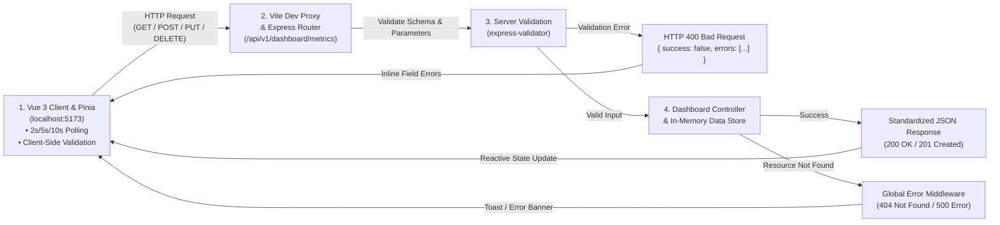

# Interactive Dashboard with Real-Time Updates and API Request Validation
### Sri Krishna College of Engineering and Technology (SKCET) — Team 7

**Tech Stack**:
- **Frontend**: Vue.js 3 (Composition API), Pinia, Vue Router, Vite
- **Backend**: Node.js, Express.js, `express-validator`, CORS

---

## 1. Project Title & Overview

The **Interactive Dashboard with Real-Time Updates and API Request Validation** is a full-stack production application built to eliminate stale operational visibility and prevent data corruption in analytics pipelines. Traditional monitoring dashboards often suffer from manual refresh latency and unvalidated client writes that corrupt reporting datasets. This project solves both challenges by delivering an automated, live operational monitoring system across four key enterprise domains: **Sales, Traffic, System, and Revenue**. The system enforces resilient, two-layer request validation—intercepting invalid inputs directly in the Vue 3 browser layer and validating all mutations on the Express.js server before changes touch the data store.

---

## 2. System Architecture & Monorepo Structure

The repository is organized as a clean, decoupled monorepo housing the backend REST API service and the modern Vue 3 single-page application (SPA):

```
Realtime-Metrics-Dashboard/
├── README.md                            # Comprehensive project overview, architecture, workflow, and run guide
├── PRODUCT.md                           # Product requirements, personas, and acceptance criteria
├── .gitignore                           # Git ignore rules (node_modules, logs, OS files)
│
├── backend/                             # Express.js REST API Service (Port 5000)
│   ├── package.json                     # Backend dependencies (express, cors, express-validator, nodemon)
│   ├── server.js                        # Server entry point, port binding, and process lifecycle handlers
│   ├── README.md                        # In-depth backend API reference, schemas, and live demo curl commands
│   └── src/
│       ├── app.js                       # Express app configuration, CORS, JSON body parser, and route mounts
│       ├── controllers/
│       │   └── dashboard.controller.js  # CRUD controller logic and in-memory dashboard metric store
│       ├── middlewares/
│       │   ├── error.middleware.js      # Custom AppError class and centralized global error handling
│       │   └── validate.middleware.js   # express-validator result formatter returning 400 Bad Request
│       ├── routes/
│       │   └── dashboard.routes.js      # REST API route declarations (/api/v1/dashboard/metrics)
│       └── validators/
│           └── dashboard.validator.js   # Declarative validation rules for bodies, route params, and queries
│
└── frontend/                            # Vue 3 Single-Page Application (Port 5173 via Vite)
    ├── package.json                     # Frontend dependencies (vue, pinia, vue-router, lucide-vue-next, vite)
    ├── vite.config.js                   # Vite configuration with reverse proxy (/api & /health -> localhost:5000)
    ├── index.html                       # HTML entry point with metadata and favicon
    ├── README.md                        # Frontend documentation, feature guides, and demo scripts
    └── src/
        ├── App.vue                      # Root Vue component with top-level navigation layout and drawer
        ├── main.js                      # Application bootstrap mounting Pinia store and Vue Router
        ├── api/
        │   └── client.js                # Centralized Fetch API client with standardized error handling
        ├── stores/
        │   ├── metrics.js               # Pinia store managing live polling, history series, and API calls
        │   └── editor.js                # Pinia store for create/edit modal drawer state
        ├── router/
        │   └── index.js                 # Vue Router configuration (/dashboard, /analytics, /manage, /metrics/:id)
        ├── views/
        │   ├── DashboardView.vue        # Main dashboard grid with status cards, category tabs, and live feed
        │   ├── AnalyticsView.vue        # Live trend chart, session stats, and category distribution breakdown
        │   ├── ManageView.vue           # Sortable, filterable metrics data table with CRUD actions
        │   ├── MetricDetailView.vue     # Dynamic single-metric drilldown view with dedicated trend graph
        │   └── NotFoundView.vue         # 404 catch-all view with back-to-dashboard navigation
        ├── components/                  # Reusable UI widgets (MetricCard, SparkLine, TrendChart, MetricDrawer, etc.)
        ├── composables/                 # Composition functions (useMetricForm for validation, useNow for clocks)
        └── styles/                      # CSS design tokens, responsive layout styles, and theme variables
```

### Team Ownership & Contributions
- **Backend Architecture & REST API (Suwetha E)**: Independently designed, implemented, and verified the entire Node.js + Express backend module (`server.js`, `app.js`, `routes/`, `controllers/`, `validators/`, `middlewares/`), including strict schema validation chains, centralized error handling, and in-memory state persistence.
- **Frontend SPA & Reactive Store**: Built the Vue 3 Composition API frontend, Pinia state management with live interval polling, dynamic SVG sparklines/trend charts, client-side validation composables, and seamless reverse-proxy integration.

---

## 3. End-to-End Application & Data Workflow



### 4-Step End-to-End Walkthrough:
1. **Vue 3 UI & Pinia Polling (`localhost:5173`)**: The client application automatically polls the backend every `2s` (with configurable `5s`/`10s` options and a live simulator toggle). When a user submits an Add or Edit form, `useMetricForm` runs client-side checks first to give instant feedback before sending the payload.
2. **Vite Dev Proxy & Express Router (`/api/v1/dashboard`)**: Vite proxies all browser calls from `/api` and `/health` directly to `http://localhost:5000`, eliminating cross-origin CORS hurdles during development and providing unified routing.
3. **Server-Side Request Validation (`express-validator`)**: The backend enforces strict data contracts:
   - `title`: required, trimmed string, 3–50 characters.
   - `value`: required, valid numeric value.
   - `category`: required, strictly constrained to `['SALES', 'TRAFFIC', 'SYSTEM', 'REVENUE']`.
   - `status`: optional, strictly constrained to `['ACTIVE', 'WARNING', 'CRITICAL']`.
   - `:id`: route parameter must be a positive integer.
4. **Controller & Standardized JSON Responses**: Valid operations update the in-memory metric store and return `200 OK` or `201 Created`. Validation failures immediately short-circuit to return structured `400 Bad Request` field-level errors (`errors: [{ field, issue }]`), which the UI maps directly next to the corresponding form inputs.

---

## 4. How to Run Locally (Full-Stack Setup)

Running the entire full-stack application requires two terminal windows:

### Terminal 1 — Start the Backend API (`localhost:5000`)
```bash
cd backend
npm install
npm run dev
```
*The backend server will start on port `5000` with auto-reload via `nodemon`.*

---

### Terminal 2 — Start the Frontend UI (`localhost:5173`)
```bash
cd frontend
npm install
npm run dev
```
*The Vite development server will start on port `5173` with Hot Module Replacement (HMR).*

---

### Live Application URLs
- **Interactive Dashboard UI**: [http://localhost:5173](http://localhost:5173)
- **Backend API Base**: [http://localhost:5000/api/v1/dashboard/metrics](http://localhost:5000/api/v1/dashboard/metrics)
- **Backend Health Check**: [http://localhost:5000/health](http://localhost:5000/health)

---

## 5. API Endpoints & Validation Examples

### REST Endpoints Summary

| Method | Endpoint | Purpose | Status Codes |
| :--- | :--- | :--- | :--- |
| `GET` | `/health` | API operational uptime and status check | `200 OK` |
| `GET` | `/api/v1/dashboard/metrics` | Retrieve all metrics (supports `?category=...` filter) | `200 OK`, `400 Bad Request` |
| `GET` | `/api/v1/dashboard/metrics/:id` | Fetch metric details by positive integer ID | `200 OK`, `400 Bad Request`, `404 Not Found` |
| `POST` | `/api/v1/dashboard/metrics` | Create a new real-time dashboard metric | `201 Created`, `400 Bad Request` |
| `PUT` | `/api/v1/dashboard/metrics/:id` | Update an existing metric and refresh timestamp | `200 OK`, `400 Bad Request`, `404 Not Found` |
| `DELETE` | `/api/v1/dashboard/metrics/:id` | Delete a metric from the store | `200 OK`, `400 Bad Request`, `404 Not Found` |

---

### Request & Response Examples

#### 1. Fetching Metrics with Category Filter (`200 OK`)
**Request**:
```http
GET /api/v1/dashboard/metrics?category=TRAFFIC HTTP/1.1
Host: localhost:5000
```
**Response**:
```json
{
  "success": true,
  "count": 1,
  "data": [
    {
      "id": 1,
      "title": "Active Platform Users",
      "value": 12450,
      "category": "TRAFFIC",
      "status": "ACTIVE",
      "updatedAt": "2026-03-30T10:00:00.000Z"
    }
  ]
}
```

---

#### 2. Creating a Valid Metric (`201 Created`)
**Request**:
```http
POST /api/v1/dashboard/metrics HTTP/1.1
Host: localhost:5000
Content-Type: application/json

{
  "title": "Checkout Conversion Rate",
  "value": 3.42,
  "category": "SALES",
  "status": "ACTIVE"
}
```
**Response**:
```json
{
  "success": true,
  "message": "Metric created successfully",
  "data": {
    "id": 4,
    "title": "Checkout Conversion Rate",
    "value": 3.42,
    "category": "SALES",
    "status": "ACTIVE",
    "updatedAt": "2026-11-26T16:19:53.146Z"
  }
}
```

---

#### 3. Intercepting Invalid Input (`400 Bad Request`)
**Request**:
```http
POST /api/v1/dashboard/metrics HTTP/1.1
Host: localhost:5000
Content-Type: application/json

{
  "title": "X",
  "value": "invalid_num",
  "category": "INVALID_CATEGORY"
}
```
**Response**:
```json
{
  "success": false,
  "message": "Validation failed",
  "errors": [
    {
      "field": "title",
      "issue": "Title must be between 3 and 50 characters"
    },
    {
      "field": "value",
      "issue": "Value must be a valid numeric value"
    },
    {
      "field": "category",
      "issue": "Category must be one of: SALES, TRAFFIC, SYSTEM, REVENUE"
    }
  ]
}
```
*(The Vue 3 frontend intercepts these field-level errors and displays them directly under the corresponding form inputs in the UI).*
